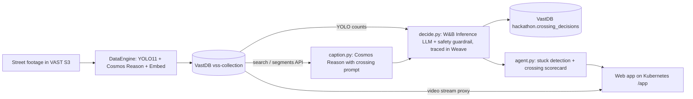

# CrossWise: a crossing copilot for sidewalk delivery robots

CrossWise watches a street crossing and, for every 5-second moment, decides **GO**, **WAIT**, or **NO-GO**, with
reasons and video evidence. If the robot would be stuck waiting too long, it **escalates** (reroute or remote-operator
handoff) so the robot never sits at a curb indefinitely. It also ranks crossings by difficulty for route planning.

> **Decision support only.** CrossWise runs on *recorded* street footage. It does not control a robot, and its
> output must not be used as the sole input for any real-world crossing decision.

Built for the VAST Builders Challenge (team-48) on a pre-deployed video understanding and search stack.

## Sponsor stack

| Tool | Used for |
|---|---|
| **VAST DataEngine** | Ingest pipeline (segmenter → YOLO detector → Cosmos reasoner → embedder → writer) that indexed the archive; re-ingest API |
| **VastDB** | `vss-collection` (indexed segments, captions, YOLO counts, embeddings) and our own table `hackathon.crossing_decisions` |
| **NVIDIA Cosmos Reason** (on CoreWeave GPUs) | Crossing-specific captions with structured tags (`SIGNAL= VEHICLES= PEDS= BLOCKED= CROSS=`) |
| **NVIDIA Cosmos Embed + YOLO11** (on CoreWeave GPUs) | Semantic search over the archive; per-segment object counts used as evidence |
| **Weights & Biases Inference** | `meta-llama/Llama-3.3-70B-Instruct` turns caption + detections into a JSON decision |
| **W&B Weave** | Traces every decision call and the agent build; W&B run logs the human evaluation |
| **Cursor** | Built end to end with the Cursor agent and the repo's VSS skills |

## How it works



1. **Find footage** (`explore_footage.py`, `assess_footage.py`): 5 crossing queries × 9 cameras through `POST /search`;
   captions scored with a keyword rubric to count clear hits. Fixed curb-level cameras (`sf_streets_cam-*`,
   `nyc_streets_cam-*`) were kept; the dashcam (`pie_cam-3`) and night bike GoPro were dropped (not a robot's viewpoint).
2. **Crossing captions** (`reingest.py`, `caption.py`): the 3 demo clips were submitted to DataEngine re-ingest with our
   crossing prompt. The shared pipeline was replaying a backlog and did not index them in time, so `caption.py` calls
   **Cosmos Reason directly** with the same prompt on each 5-second segment (≈4–6 s per call; 18 segments in under 30 s with 4 workers).
3. **Decide** (`decide.py`): caption + YOLO counts (+ Cosmos tags when present) → W&B Inference (JSON mode, temperature 0)
   → `{decision, unclear, signal, hazards[], reasons[], confidence}`.
   - GO only on clear evidence (walk/green, no vehicle in or turning through the crosswalk, path passable).
   - WAIT when it should clear soon, and **whenever evidence is unclear** (marked `unclear`).
   - NO-GO for immediate danger or no passable path.
   - **Guardrail in code:** a GO is downgraded to WAIT if Cosmos tagged `VEHICLES=turning` or `BLOCKED=yes`, or the model
     marked the evidence unclear. The model's raw answer is kept as `llm_decision` for evaluation.
   - Prompts forbid describing individuals or licence plates; index captions (which can describe people) are never shown.
4. **Agent** (`agent.py`, standard library only, imported by the app):
   - **Stuck detection:** N consecutive non-GO segments (default 4 = 20 s, configurable in the UI) fire one escalation
     per streak. Action = **REROUTE** if ≥ half the streak shows a blocked crosswalk/construction (with the easiest
     same-city crossing suggested), otherwise **REMOTE_OPERATOR** (unclear evidence, no safe traffic gap, or long signal wait).
   - **Crossing scorecard per camera:** share of GO time, mean wait before a GO, turning-vehicle hazards, NO-GO share,
     escalations. Difficulty 0–100 = 50% time without GO + 20% NO-GO share + 20% mean wait (capped 30 s) + 10% turning rate.
5. **App** (`app/`): stdlib Python backend + one HTML page (Chart.js from CDN), deployed with `python:3.12-slim`, code from
   a ConfigMap, VSS credentials from a Secret, Ingress `/app`. Video is proxied with HTTP Range support; the JWT never
   reaches the browser. Features: player with live GO/WAIT/NO-GO badge, reasons and evidence, decision timeline with a
   tiny robot riding the playhead, escalation banner, **replay mode** (steps through a clip as if live, labelled REPLAY),
   crossing scorecard, archive search, and a blind labelling page (`/app/label`).

## Repository layout

```
crosswise/
  vss.py               VSS retrieval API client (login, cached JWT, retry on 401)
  explore_footage.py   Phase 1 searches -> tmp/phase1_search.json
  assess_footage.py    Phase 1 rubric + parent-video ranking
  reingest.py          crossing prompt + DataEngine re-ingest (start / monitor)
  caption.py           direct Cosmos Reason captioning -> data/cosmos_captions.json
  decide.py            decision engine -> data/decisions.json + VastDB + Weave
  agent.py             stuck detection + scorecard -> data/agent_output.json
  evaluate.py          label-set selection + human-eval scoring + W&B run
  app/main.py          web backend (stdlib)      app/index.html  UI      app/label.html  labelling UI
  deploy/k8s.yaml      Deployment + Service + Ingress (no secrets)      deploy/deploy.sh
  data/                generated outputs used by the app (no captions that describe people)
```

## Setup

The stack (VSS backend, DataEngine, VastDB, GPU models) is pre-deployed. Credentials come from environment variables
(from the team config file); none are stored in this repo.

| Variable | Purpose |
|---|---|
| `INGRESS_URL`, `USERNAME`, `PASSWORD` | VSS retrieval API (JWT login) |
| `S3_ENDPOINT`, `ACCESS_KEY`, `SECRET_KEY`, `VASTDB_BUCKET` | VastDB SDK (data VIP) |
| `GPU_BEARER_TOKEN`, optional `COSMOS3_REASON_URL` | Cosmos Reason on the GPU host |
| `WANDB_API_KEY`, `WANDB_TEAM`, `WANDB_PROJECT` | W&B Inference, Weave, W&B runs |
| `KUBECONFIG` | deploy to the team namespace |

```bash
python3 -m venv .venv && . .venv/bin/activate && pip install -r requirements.txt
```

## Reproduce

```bash
python explore_footage.py && python assess_footage.py     # find crossing footage (Phase 1)
python reingest.py                                         # optional: DataEngine re-ingest with the crossing prompt
python caption.py                                          # Cosmos Reason captions for the demo clips
python decide.py                                           # decisions for demo clips + 5 clips per street camera
python agent.py --n 4                                      # escalations + scorecard
./deploy/deploy.sh                                         # web app at /app (open via the workshop App button)
python evaluate.py select                                  # pick 20 segments for blind labelling
#   label them at /app/label, then:
python evaluate.py score                                   # agreement, unsafe GOs, W&B run
```

## Inputs and outputs

**Inputs:** indexed segments from `vss-collection` (5-second H.264 clips grouped in 30-second chunks), their YOLO11
object counts, Cosmos Reason captions (our prompt), and for the scorecard sample the original index captions.

**Output table** `hackathon.crossing_decisions` (VastDB, one row per segment per run):
`run_id, segment_id, original_video, camera_id, location, segment_number, start_sec, end_sec, caption_source,
cosmos_tags (json), yolo_counts (json), decision, llm_decision, unclear, signal, hazards (json), reasons (json),
confidence, model, created_at`. The same rows are in `data/decisions.json`.

**Agent output:** `data/agent_output.json` with per-clip escalations `{at_sec, waited_s, action, reason}` and the scorecard.

**Current run:** 228 segments (18 demo segments with Cosmos captions + 210 segments from 35 clips across 7 street
cameras). Demo clips: `sf_streets_cam-4` (long red, escalates at 20 s → remote operator), `sf_streets_cam-1`
(turning traffic and a stopped truck, GO every ~10 s, no escalation), `nyc_streets_cam-1` (don't-walk + cones and
barrier, escalates at 20 s → reroute).

## Evaluation

Method: 20 segments, stratified by decision (8 GO, 6 WAIT, 6 NO-GO) and spread across all 7 cameras, selected with a
fixed seed (`evaluate.py select`). A human labelled each as **safe** or **unsafe** for a robot to *start* crossing,
**blind** to the model's decision (`/app/label`). GO counts as "safe"; WAIT and NO-GO count as "not safe now".
Unsafe GOs (GO where the human said unsafe) are the critical error and are reported separately.

<!-- EVAL_RESULTS -->

## Limitations

- **Recorded footage, decision support only.** No real-time control, no robot integration.
- **Small evaluation:** 20 labels from one labeller; GO is deliberately over-sampled, so agreement is not a population estimate.
- **Signal ambiguity:** a fixed camera often sees the *vehicle* light, not the pedestrian signal. The prompt treats a bare
  traffic-light colour as weaker evidence than a walk/don't-walk signal, but misreads remain.
- **Index captions are weaker than our crossing captions.** Scorecard clips use the original index captions, which rarely
  mention signal state (none in ~48% of segments) or turning vehicles, so turning hazards are under-counted outside the demo
  clips and NO-GO is over-represented ("vehicles moving over the crosswalk").
- **Short clips:** chunks are 30 s, so "wait before GO" is a lower bound (streaks that never reach a GO count at their observed length).
- **Scorecard sample:** 5–6 clips per camera; the ranking is directional.
- **Re-ingest:** the shared DataEngine pipeline was replaying a backlog during the event, so crossing captions were produced by
  calling Cosmos Reason directly (same prompt, same model family) and stored in our own table rather than `vss-collection`.
- **Chunk videos are HEVC;** the app plays the H.264 segment files back to back instead.

## Privacy

Prompts instruct Cosmos Reason and the decision model never to describe individual people or licence plates. Original index
captions (which sometimes describe clothing) are never displayed or committed; only decisions, reasons, signal state,
hazards, and object counts are stored in `data/`.
